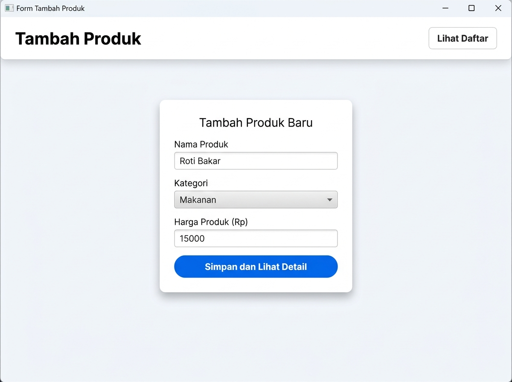
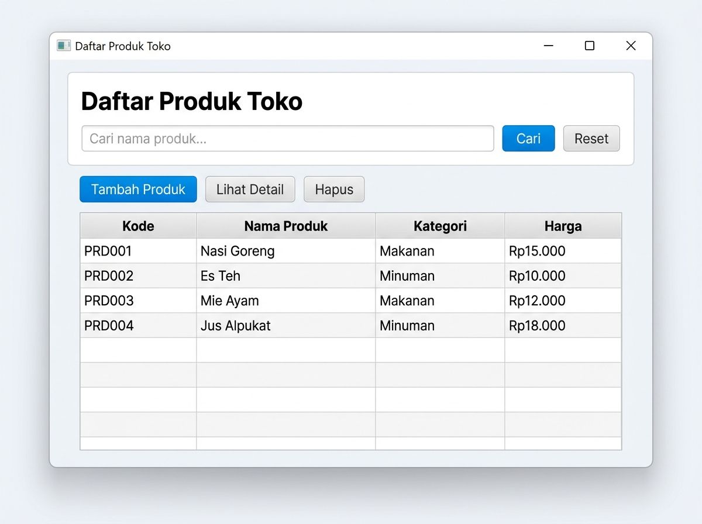
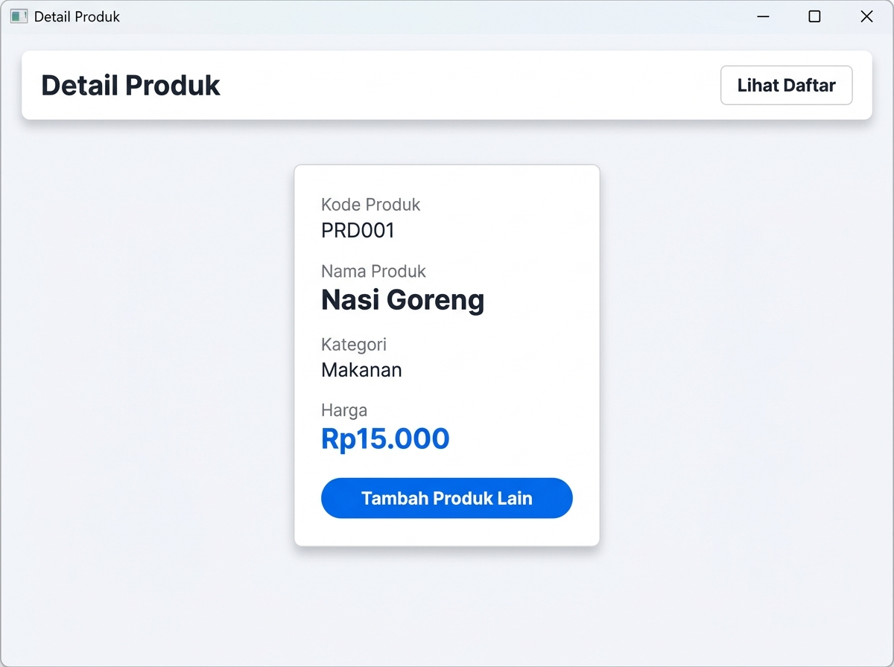

# Daftar Produk Toko — JavaFX App

Aplikasi desktop manajemen produk toko berbasis JavaFX (GUI lanjutan). Dibangun dengan pola MVC menggunakan FXML + SceneBuilder.

## Teknologi

| Komponen | Versi |
|---|---|
| Java | 17+ |
| JavaFX | 21 |
| Build Tool | Apache Maven |
| UI Designer | SceneBuilder |

## Struktur Proyek

```
src/main/
├── java/kelas/
│   ├── MainApp.java               # Entry point JavaFX Application
│   ├── Navigator.java             # Navigasi antar halaman
│   ├── model/
│   │   └── Produk.java            # Model data produk
│   ├── data/
│   │   └── DataProduk.java        # Repository data (in-memory)
│   └── controller/
│       ├── FormController.java    # Controller form tambah produk
│       ├── DaftarController.java  # Controller tabel daftar produk
│       └── DetailController.java  # Controller detail produk
└── resources/kelas/
    ├── form.fxml                  # Layout form tambah
    ├── daftar.fxml                # Layout tabel produk
    ├── detail.fxml                # Layout detail produk
    └── styles/app.css             # Stylesheet global
```

## Cara Menjalankan

```bash
mvn clean javafx:run
```

Atau dari IDE (NetBeans/IntelliJ): jalankan `MainApp.java`.

## Fitur

- **Tambah Produk** — input nama, pilih kategori (Makanan/Minuman), input harga bebas
- **Daftar Produk** — tabel dengan kolom Kode, Nama, Kategori, Harga (format Rupiah)
- **Pencarian** — filter produk berdasarkan nama secara real-time
- **Detail Produk** — tampil info lengkap produk setelah disimpan
- **Hapus Produk** — hapus dengan konfirmasi dialog
- **Validasi Input** — nama tidak boleh kosong, harga harus > 0

## Model Data

### `Produk`

```java
private final String kode;      // Auto-generate: PRD001, PRD002, ...
private final String nama;      // Nama produk (wajib diisi)
private final String kategori;  // Makanan / Minuman
private final double harga;     // Harga satuan (Rp, harus > 0)
```

## Screenshot UI (SceneBuilder Preview)

### Form Tambah Produk



---

### Daftar Produk Toko



---

### Detail Produk



## Navigasi Antar Halaman

```
[Form Tambah] --Simpan--> [Detail Produk]
     ^                          |
     |                    Tambah Produk Lain
     |
[Daftar Produk] <--Lihat Daftar-- (semua halaman)
     |
  Tambah Produk
```

